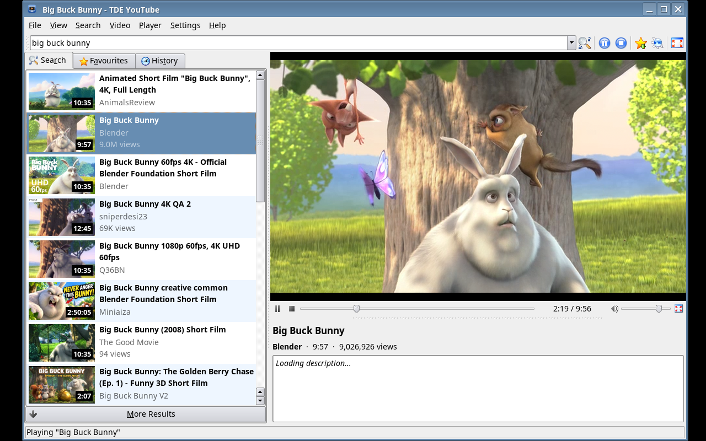
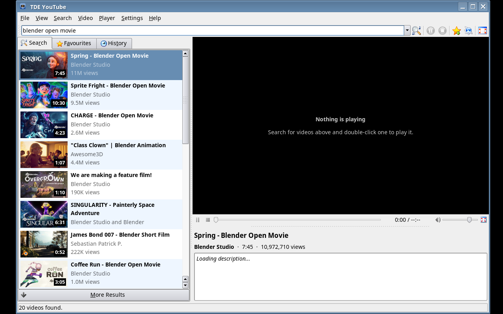
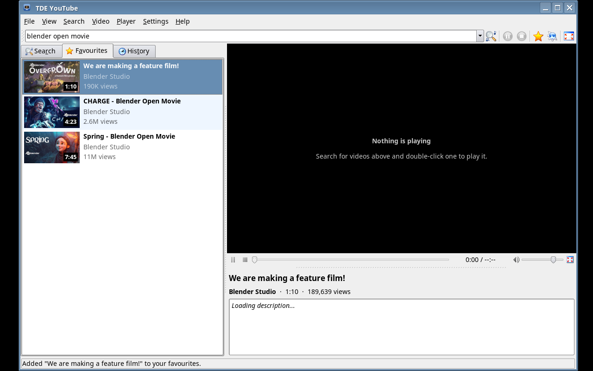
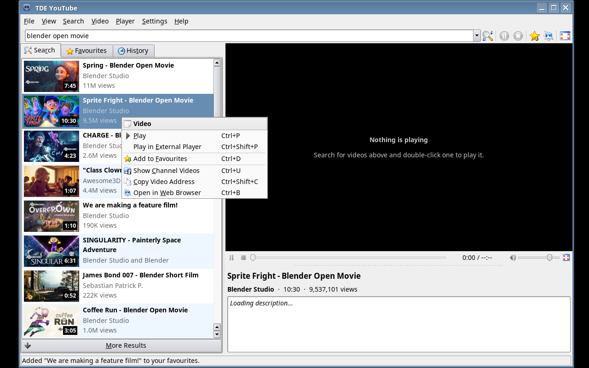
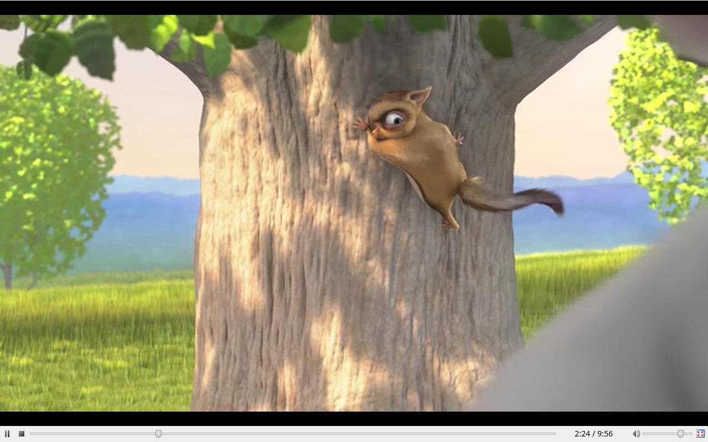
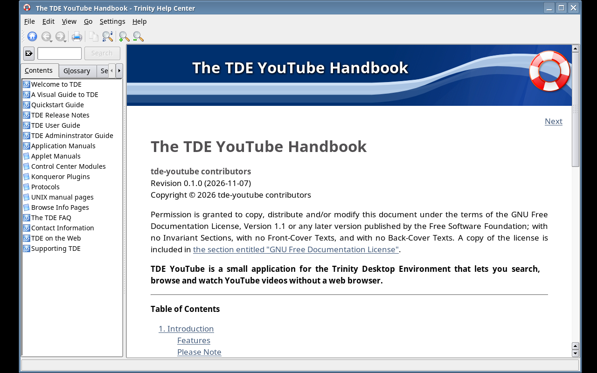
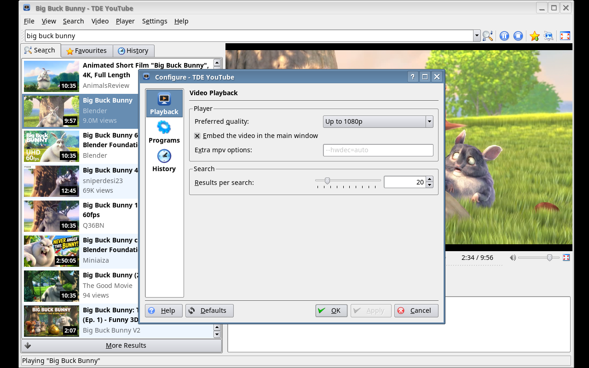
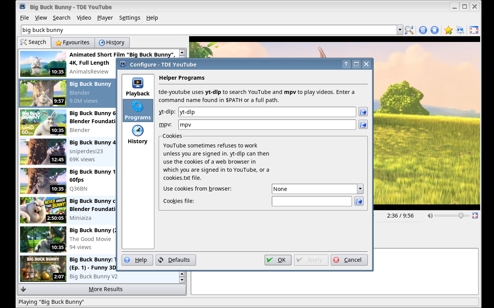

# TDE YouTube

[](https://github.com/Yjlion/tde-youtube/actions/workflows/build-deb.yml)

A native [Trinity Desktop Environment](https://www.trinitydesktop.org/) (TDE)
application to search, browse and watch YouTube videos without a web browser.



> [!WARNING]
> **Vibecode disclaimer.** This project was written largely by an AI coding
> assistant ("vibe coded"), with a human giving direction. The code has been
> built and tried out, but it has **not** been carefully reviewed or audited.
> Expect rough edges and bugs. Use it at your own risk; it comes with no
> warranty of any kind (see [COPYING](COPYING)). Reviews, bug reports and
> patches are very welcome.
>
> TDE YouTube is **not affiliated with, endorsed or sponsored by YouTube or
> Google**. "YouTube" is a trademark of Google LLC. Please respect YouTube's
> terms of service and the rights of the people who make the videos.

## Features

- Search YouTube from the tool bar, with a remembered search history
- Paste the address of a video, playlist or channel to open it
- Result lists with thumbnails, duration, channel and view count
- Video player embedded in the main window (or a separate mpv window)
- Play/pause, stop, seek, volume and full screen mode
- Choice of quality: best, 1080p, 720p, 480p, 360p or audio only
- Video details: full description (with clickable links), likes, upload date
- Favourites and watch history, stored locally
- "Show channel videos", "Copy video address", "Open in web browser"
- Optional use of your browser's cookies when YouTube asks you to sign in
- Keeps its own copies of yt-dlp and QuickJS-ng up to date, so playback
  keeps working when YouTube changes
- Standard TDE integration: configurable shortcuts and tool bars, a
  handbook in KHelpCenter (F1) and a man page

TDE YouTube doesn't talk to YouTube itself. It uses
[yt-dlp](https://github.com/yt-dlp/yt-dlp) to search and read video
information, and [mpv](https://mpv.io) to play videos. You don't need a
YouTube account or API key.

## Screenshots

| | |
|---|---|
|  |  |
| Search results | Playing a video |
|  |  |
| Favourites | Context menu |
|  |  |
| Full screen mode | The handbook in KHelpCenter |
|  |  |
| Settings: playback | Settings: programs and cookies |

The screenshots are made by
[`tools/screenshots/take-screenshots.sh`](tools/screenshots/take-screenshots.sh).
YouTube blocks video streams for data-centre machines like the one the
screenshots were made on. So in the "playing" screenshots, the video is a
local copy of the Creative Commons film *Big Buck Bunny* (© Blender
Foundation, CC BY 3.0) from download.blender.org, and the description is
still loading. The search results and thumbnails are real.

## Installing

### Debian package

Each push builds `.deb` packages for Debian 13 (trixie) and Debian 12
(bookworm) with the [Trinity R14.1.x repository](https://wiki.trinitydesktop.org/Debian_Trinity_Repository_Installation_Instructions).
Download them from the artifacts of the
[latest workflow run](https://github.com/Yjlion/tde-youtube/actions/workflows/build-deb.yml),
or from the [releases](https://github.com/Yjlion/tde-youtube/releases) for
tagged versions. Then:

```sh
sudo apt install ./tde-youtube_0.2.0_amd64_trixie.deb
```

This also installs `mpv` and `python3`.

> [!IMPORTANT]
> YouTube changes often, and distribution packages of `yt-dlp` are usually
> too old to work: Debian 13's (2025.04.30) can still search, but playing
> fails with *"The page needs to be reloaded."*, and bookworm's is older still,
> even in backports. Debian's yt-dlp also lacks the
> [yt-dlp-ejs](https://github.com/yt-dlp/ejs) challenge solver.
>
> So TDE YouTube **downloads its own helper programs** on first start and
> keeps them up to date, into `~/.trinity/share/apps/tde-youtube/bin/`:
>
> - the official [portable yt-dlp](https://github.com/yt-dlp/yt-dlp#installation)
>   (about 3 MB, runs with Python 3.10 or newer, includes yt-dlp-ejs),
>   verified against the release's `SHA2-256SUMS`;
> - the [QuickJS-ng](https://github.com/quickjs-ng/quickjs/releases)
>   JavaScript engine (a static `qjs`, about 2.5 MB, for x86_64, aarch64,
>   armv7, x86 and riscv64), which yt-dlp uses to solve YouTube's challenges,
>   verified against the SHA-256 digest GitHub publishes for it.
>
> It checks for new versions once a day and whenever YouTube refuses a video.
> You can turn this off under *Settings → Configure TDE YouTube → Programs*;
> TDE YouTube then uses the installed `yt-dlp` and `qjs` (the packages are
> suggested, not required).

### Building from source

You need the TDE development packages, CMake and a C++ compiler. On Debian
or Ubuntu with the Trinity repository:

```sh
sudo apt install build-essential cmake tde-cmake tdelibs14-trinity-dev \
                 libtqt3-mt-dev tqt3-dev-tools libtqtinterface-dev
mkdir build && cd build
cmake .. -DCMAKE_INSTALL_PREFIX=/opt/trinity
make
sudo make install
```

To build the Debian package yourself, run `dpkg-buildpackage -us -uc -b`
in the source tree.

At run time you need `mpv` (0.35 or newer recommended) and Python 3.10 or
newer for the downloaded yt-dlp. If you turn the downloads off, install
`yt-dlp` (and `quickjs` or deno) yourself.

## Usage

Start *TDE YouTube* from the K menu (*Multimedia*) or run `tde-youtube`:

```sh
tde-youtube                                   # just open the window
tde-youtube --search "blender open movie"     # search on start-up
tde-youtube https://www.youtube.com/watch?v=… # play a video
tde-youtube https://www.youtube.com/@channel  # list a channel's videos
```

| Shortcut | Action |
|---|---|
| Ctrl+F | Focus the search box |
| Enter | Search / play the selected video |
| Space | Pause / resume |
| Ctrl+Left / Ctrl+Right | Skip 10 seconds |
| Ctrl+Up / Ctrl+Down | Volume |
| Ctrl+Shift+F, double-click, F | Full screen (Esc leaves it) |
| Ctrl+D | Add to / remove from favourites |
| Ctrl+1 / 2 / 3 | Search results / Favourites / History |

See the handbook (press F1, or open `help:/tde-youtube` in KHelpCenter)
and `man tde-youtube` for the full documentation.

### "Sign in to confirm you're not a bot"

YouTube sometimes refuses requests unless you are signed in, especially on
shared or data-centre networks. Under *Settings → Configure TDE YouTube →
Programs → Cookies*, pick a web browser in which you're signed in to YouTube.
yt-dlp will then use that browser's cookies. You can also choose a
`cookies.txt` file.

## Files

| Path | Contents |
|---|---|
| `~/.trinity/share/config/tde-youtuberc` | Settings, search history, window layout |
| `~/.trinity/share/config/tde-youtube-libraryrc` | Favourites and watch history |
| `~/.trinity/share/cache/tde-youtube/thumbs/` | Thumbnail cache |

## Repository layout

```
src/                  application source (C++, TQt3, tdelibs)
icons/                application icon (hicolor PNGs + SVG)
doc/en/index.docbook  the KHelpCenter handbook
doc/man/tde-youtube.1 the man page
debian/               Debian packaging
.github/workflows/    CI: builds the .deb packages
screenshots/          screenshots used here and in the handbook
tools/                Docker images and the screenshot script
```

## License

TDE YouTube is free software under the GNU General Public License, version 2
or (at your option) any later version; see [COPYING](COPYING). The
documentation is under the GNU Free Documentation License.
